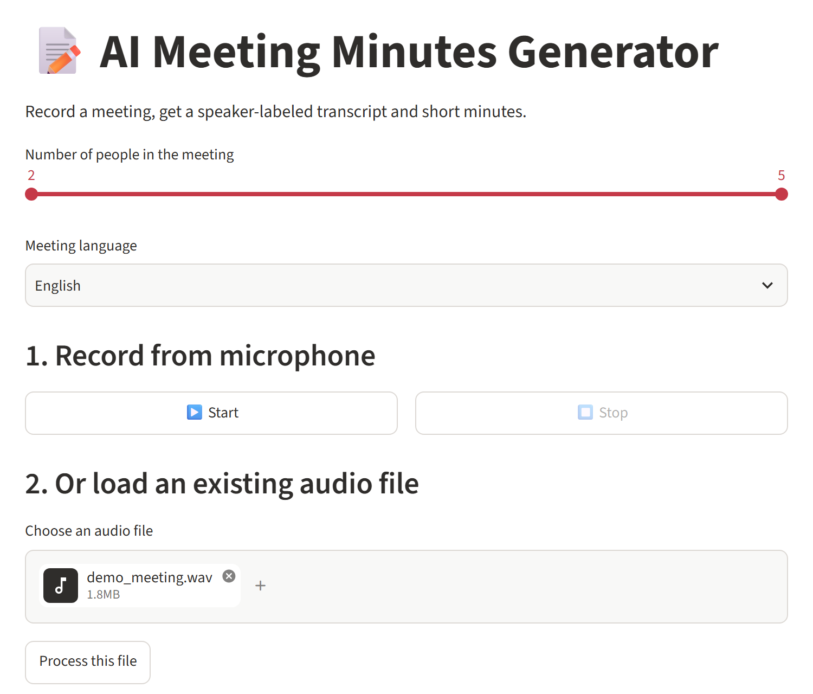
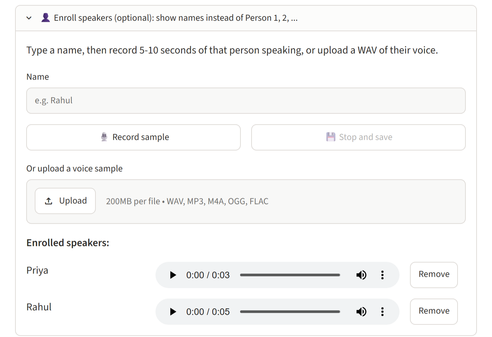
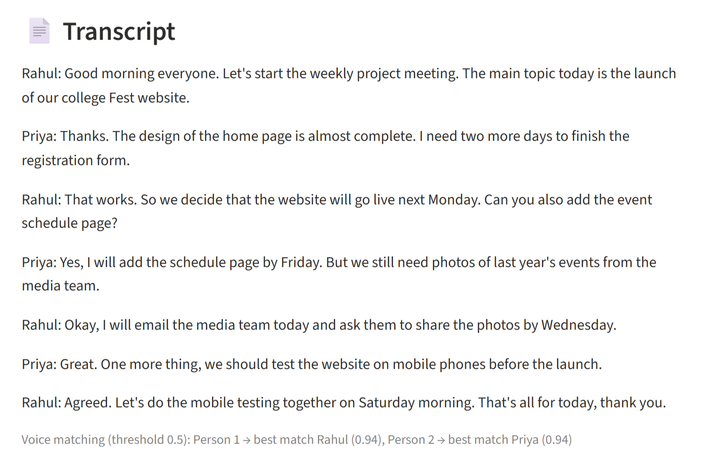
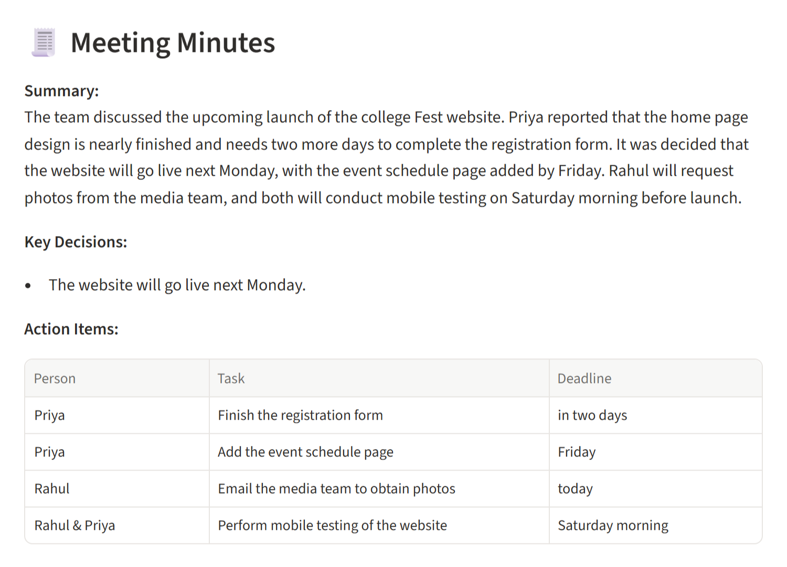
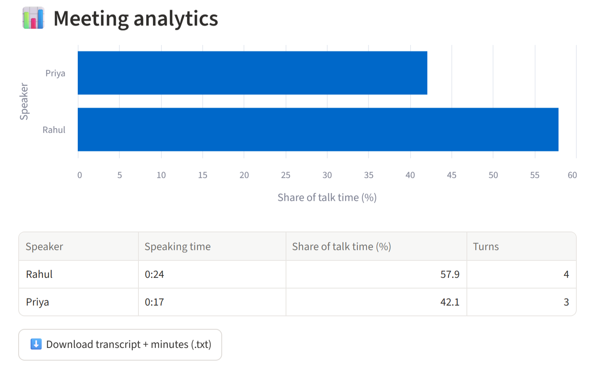
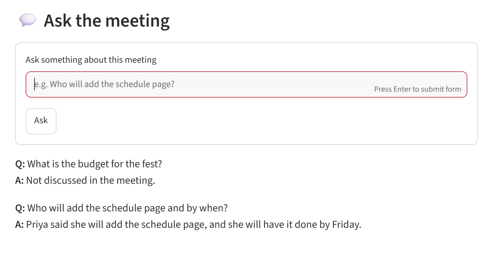

# AI Meeting Minutes Generator

Click **Start**, let people talk, click **Stop**. The app shows:

- a **speaker-labeled transcript** (`Person 1: ...`, `Person 2: ...`, or real names such as `Rahul: ...` for enrolled speakers)
- short **meeting minutes**: summary, key decisions, and an **action items table** (person, task, deadline)
- **meeting analytics**: speaking time, share of talk time and number of turns per speaker, with a bar chart
- **Ask the meeting**: type a question and get an answer taken only from the transcript
- a **download button** for a `.txt` file with the transcript and minutes

Everything except the minutes runs **on your laptop's CPU**. After the first run the models are saved on disk, so it works offline.

## Screenshots

All screenshots show the included 58-second demo meeting (`samples/demo_meeting.wav`) with two enrolled speakers.

| Home page | Speaker enrollment |
|:---:|:---:|
|  |  |
| **Transcript with real names** | **Minutes with action-items table** |
|  |  |
| **Meeting analytics** | **Ask the meeting** |
|  |  |

## Quick start

```powershell
git clone https://github.com/Prakhar007-cyber/MajorProject_Ai_meeting_minutes_generator_Prakhar_Bhatnagar.git
cd MajorProject_Ai_meeting_minutes_generator_Prakhar_Bhatnagar
py -3.12 -m venv venv
venv\Scripts\activate
pip install -r requirements.txt
copy .env.example .env      # then open .env and paste your two keys (see Setup below)
streamlit run app.py        # opens http://localhost:8501
```

Upload `samples/demo_meeting.wav` and click **Process this file** to see the full output without recording anything.

## How it works

```
Mic ──► recorder.py ──► meeting.wav
                           │
            ┌──────────────┴──────────────┐
            ▼                             ▼
     transcriber.py                 diarizer.py
  (faster-whisper: what           (pyannote: who spoke
   was said + timestamps)          when + timestamps)
            └──────────────┬──────────────┘
                           ▼
            merge by timestamp overlap  ──►  "Person 1: ..."
                           ▼
        enroller.py: match voices with enrolled/ ──►  "Rahul: ..."
                           ▼
          ┌────────────────┼─────────────────┐
          ▼                ▼                 ▼
   summarizer.py      analytics.py         qa.py
   (minutes +         (talk time,        (answers questions
   action items)       turns, chart)      from the transcript)
          └────────────────┼─────────────────┘
                           ▼
                  app.py (Streamlit UI)
```

| File | What it does |
|------|-------------|
| `app.py` | Streamlit web page: buttons, spinner, results, download |
| `recorder.py` | Records the mic and saves a 16 kHz WAV file |
| `transcriber.py` | Speech to text with timestamps (faster-whisper) |
| `diarizer.py` | Finds speakers (pyannote) and merges them with the text |
| `summarizer.py` | Sends the transcript to an LLM and gets the minutes back; reads the action items as a table |
| `enroller.py` | Saves voice samples in `enrolled/` and replaces Person N with the matching enrolled name |
| `qa.py` | Answers a question about the meeting using only the transcript |
| `analytics.py` | Speaking time, share of talk time and number of turns per speaker |

## Setup (Windows, one time)

**Prerequisites**

| Need | Notes |
|------|-------|
| Windows 10/11 laptop with a microphone | Any modern CPU; no GPU needed. 8 GB RAM recommended |
| Python 3.12 | https://www.python.org/downloads/ (tick **Add Python to PATH**) |
| Git | https://git-scm.com/download/win, to clone the repository |
| ~3 GB free disk space | Python packages (~1 GB) + Whisper and pyannote models (~550 MB, downloaded on first run) |
| Internet for the first run | Downloads the models; afterwards only the minutes / Q&A step needs internet |
| Free Hugging Face account and Groq account | For the two keys in steps 3 and 4 |

**1. Python 3.12** (Python 3.13/3.14 may not have the needed ML packages yet.)

```powershell
py -3.12 -m venv venv
venv\Scripts\activate
pip install -r requirements.txt
```

`requirements.txt` installs the CPU-only version of PyTorch. The first install downloads about 1 GB.

**2. ffmpeg (optional).** You do *not* need a system ffmpeg. faster-whisper uses the PyAV library, which includes its own ffmpeg, and the app reads WAV files with `soundfile`. To check whether you have it anyway, run `ffmpeg -version`.

**3. Hugging Face token (for speaker labels)**

1. Create a free account at https://huggingface.co
2. Open each of these pages, log in, and click **"Agree and access repository"**:
   - https://huggingface.co/pyannote/speaker-diarization-3.1
   - https://huggingface.co/pyannote/segmentation-3.0
3. Go to https://huggingface.co/settings/tokens, click **Create new token**, choose type **Read**, and copy it (it starts with `hf_`).

**4. Groq API key (for minutes, free tier)**

1. Sign up at https://console.groq.com
2. Open **API Keys** → **Create API Key** and copy it (it starts with `gsk_`).

**5. Create the `.env` file**

Copy `.env.example` to `.env` and paste your keys:

```
HF_TOKEN=hf_xxxxxxxxxxxxxxxx
GROQ_API_KEY=gsk_xxxxxxxxxxxxxxxx
```

If `GROQ_API_KEY` is missing, the app skips the minutes and still shows the transcript. If `HF_TOKEN` is missing, the transcript is shown without speaker labels.

## Run

```powershell
venv\Scripts\activate
streamlit run app.py
```

The page opens at http://localhost:8501.

- **Start / Stop**: records from the laptop mic.
- **Load existing audio file**: backup for a noisy room. Try `samples/demo_meeting.wav` (a 2-speaker sample meeting).
- **Number of people** slider: tell the app how many speakers to expect (2 to 5).

## New features and how to use them

**1. Speaker enrollment (names instead of Person 1, 2, ...)**

1. Open **👤 Enroll speakers (optional)** near the top of the page.
2. Type a name, click **🎙️ Record sample**, let that person speak for 5-10 seconds, then click **💾 Stop and save**. Or upload a WAV/MP3 of their voice and click **Save uploaded sample**.
3. Repeat for each person. Enrolled people are listed with a play button and a **Remove** button. Samples are stored as `enrolled/<name>.wav` (git-ignored).
4. Process a meeting as usual. Every detected speaker whose voice matches an enrolled sample is shown by name in the transcript, minutes, analytics and Q&A. Other speakers stay `Person N`.

Under the transcript, a small line shows the best match and similarity of each speaker, for example `Person 1 → best match Rahul (0.94)`. A speaker gets the name only if the similarity is at least `MATCH_THRESHOLD` at the top of `enroller.py` (default `0.5`). Raise it if wrong names appear; lower it if real people are not recognised. If nobody is enrolled, the app behaves exactly as before.

**2. Ask the meeting**

After a meeting is processed, type a question in **💬 Ask the meeting** (for example *Who will add the schedule page?*) and click **Ask**. The answer comes only from the transcript; if the meeting did not cover it, the answer is *Not discussed in the meeting.* Earlier questions and answers stay on the page (newest first) until the next meeting is processed.

**3. Meeting analytics**

The **📊 Meeting analytics** section shows a bar chart of each speaker's share of the talking and a table with speaking time (m:ss), share of talk time (%) and number of turns. Back-to-back turns by the same person count as one turn. Analytics need speaker labels, so they are hidden when `HF_TOKEN` is missing.

**4. Action items table**

The minutes now list action items as a table with **Person**, **Task** and **Deadline** ("Not specified" when no deadline was said). If the LLM answer cannot be read as a table, the minutes are shown as plain text as before. The downloaded `.txt` file contains the action items as text lines.

## Test each part on its own

```powershell
python recorder.py                              # records 5 s into test_recording.wav
python transcriber.py samples\demo_meeting.wav  # prints text with timestamps
python diarizer.py samples\demo_meeting.wav     # prints speaker turns + labeled transcript
python summarizer.py                            # prints minutes + parsed action items for a tiny fake transcript
python qa.py                                    # answers 3 questions about a tiny fake transcript
python analytics.py                             # prints the talk-time table for made-up turns
python enroller.py samples\demo_meeting.wav     # matches the meeting speakers with the people in enrolled/
```

## Offline use

The first run downloads the models (Whisper "small" is about 500 MB, pyannote about 30 MB) into `C:\Users\<you>\.cache\huggingface`. After that, transcription and speaker labeling run offline. To stop the app from even checking the internet, add this line to `.env`:

```
HF_HUB_OFFLINE=1
```

Only the minutes step (Groq) needs internet.

## Tips for the demo

- Processing on a CPU takes roughly half to the same time as the audio length (tested: a 3-minute meeting took about 1.5 minutes). Keep demo meetings to 1–3 minutes.
- Pick the **Meeting language** in the dropdown. Auto-detect can guess wrong on noisy audio.
- Use real conversation for testing. Crowd or background-noise recordings give nonsense text and a single "speaker".
- Put the laptop in the middle of the table. People should take turns and not talk over each other.
- To use Gemini instead of Groq, change `generate_minutes()` in `summarizer.py` and `answer_question()` in `qa.py`.
- Enroll speakers in the same room and with the same microphone as the meeting. Samples of 5-10 seconds of normal speech work best.
